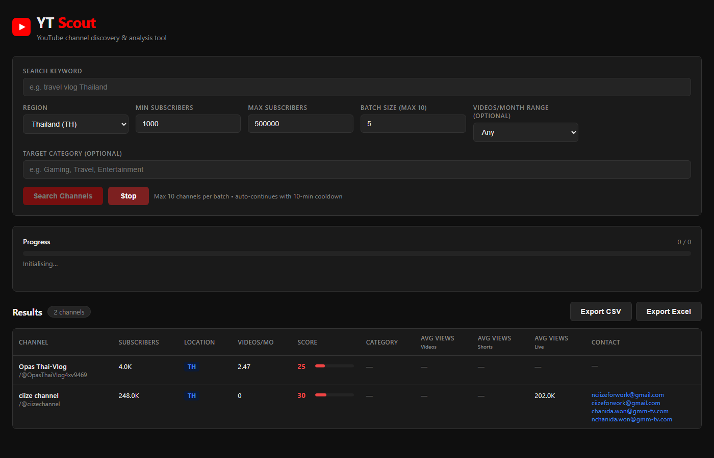

# YT Scout

YouTube channel discovery and analysis tool for finding Thai creators. Scrapes YouTube search results, verifies Thai origin, and extracts subscriber counts, view averages, upload frequency, contact emails, and external links.



## Features

- **Thailand-first filtering** — keeps only channels with Thai script, confirmed TH location, or no positively-confirmed non-Thai country
- **Subscriber range filter** — min/max bounds; channels outside range are skipped immediately
- **Videos/Month Range** — filter by upload frequency (0–10, 11–20, 21–30, 31–40, 50+)
- **Target Category** — filter by YouTube genre (Gaming, Travel, Entertainment, etc.)
- **Hardened view extraction** — 3-attempt retry with scroll + networkidle per tab; 90-second hard cap per tab
- **Graceful fallbacks** — failed extractions become `Pending Check`, never break the scrape loop
- **Channel discovery** — after scraping a matching channel, discovers related channels from its Channels tab
- **Multi-batch auto-loop** — runs continuously with a 10-minute cooldown between batches
- **Export** — CSV and Excel download

## Setup

```bash
pip install flask playwright playwright-stealth openpyxl
playwright install chromium
```

## Run

```bash
python app.py
```

Open `http://127.0.0.1:8080`.

## Filters and scoring

| Signal | Points |
|---|---|
| Subscriber count tier | up to 25 |
| Video views / subs ratio | up to 30 |
| Shorts views / subs ratio | up to 20 |
| Upload frequency | up to 15 |
| TH / TH inferred location | 10 |
| **Max** | **100** |
